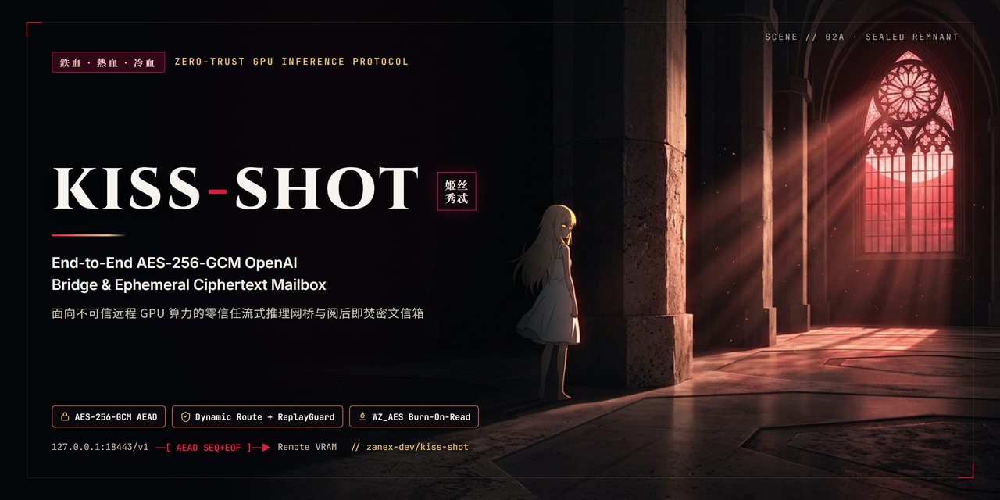

<p align="center">
  
</p>

<h1 align="center">Kiss-Shot (姬丝秀忒)</h1>

<p align="center">
  <strong>Zero-Trust End-to-End Encrypted (<code>AES-256-GCM</code>) OpenAI Inference Bridge &amp; Ephemeral Ciphertext Mailbox for Remote GPUs.</strong>
</p>

<p align="center">
  <a href="#verification--test-suite"></a>
  <a href="LICENSE"></a>
  <a href="pyproject.toml"></a>
  
</p>

<p align="center">
  <a href="README.md"><strong>English</strong></a> · <a href="README_ZH.md"><strong>简体中文</strong></a>
</p>

---

When renting cloud GPUs on shared or third-party infrastructure (RunPod, Vast.ai, Lambda, AutoDL, or remote Jupyter pods), standard HTTPS ingress proxies terminate TLS at the provider's edge—exposing plaintext prompts, proprietary system instructions, multimodal images, and generated media to edge gateways, reverse-proxy logs, and shared disks.

**`kiss-shot`** (*Codename: Kiss-Shot / 姬丝秀忒*) establishes an application-layer zero-trust cryptographic bond directly from `127.0.0.1` on your local workstation into the remote GPU process memory:

1. **Streaming OpenAI-Compatible AEAD Bridge**: Exposes a standard `http://127.0.0.1:18443/v1` endpoint locally (drop-in for the OpenAI SDK, LangChain, Cursor, Continue, OpenWebUI, or SillyTavern) while sealing every request and streaming SSE token chunk with `PBKDF2-HMAC-SHA256` (`210,000` iterations) + `AES-256-GCM`.
2. **Dynamic Ephemeral Routing & Anti-Replay**: Each remote gateway session generates a fresh random route (`/v1/ks-<random>`) and 128-bit session salt embedded inside an authenticated `KISSSHOT_TICKET:...` handshake string, backed by a timestamp window (`±300s`) and a bounded request-ID replay filter (`ReplayGuard`). Unauthenticated scanners immediately receive `403 Forbidden`.
3. **Stream Integrity & Truncation Detection**: Streaming SSE chunks bind monotonic sequence numbers (`kissshot-s2c:<req_id>:<seq>`) and an authenticated termination tag (`EOF:...`) into GCM Additional Authenticated Data (AAD), defeating chunk reordering, injection, and silent middlebox truncation.
4. **Burn-After-Reading Ciphertext Mailbox**: For asynchronous Diffusion/Video workloads (`SDXL`, `FLUX.1-schnell`, `Wan 2.1/2.2`), prompts and reference images are encrypted locally, inferred purely in memory (`BytesIO` / `/dev/shm`), packed into `256-bit WinZip AES` (`WZ_AES`, `ZIP_STORED` zero-compression to eliminate compression-ratio side channels, with obfuscated inner filenames), relayed via a private HuggingFace repository, and **deleted from remote storage immediately after verified local decryption**.

---

## Architecture

```mermaid
flowchart LR
    subgraph Workstation["Local Workstation (Trusted)"]
        Client["OpenAI SDK / WebUI / CLI"]
        LocalBridge["kiss-shot (127.0.0.1:18443/v1)"]
        Client -->|"Plaintext HTTP (Loopback)"| LocalBridge
    end

    subgraph UntrustedNet["Edge Proxy / Public Network (Untrusted)"]
        Edge["Cloud Ingress / Reverse Proxy"]
    end

    subgraph GPUHost["Remote GPU Container"]
        RemoteGW["RemoteAEADGateway (:8081 /v1/ks-random)"]
        Engine["llama-server / vLLM / Ollama (127.0.0.1:8080)"]
        RemoteGW -->|"Decrypted Loopback"| Engine
    end

    LocalBridge <-->|"High-Entropy AES-256-GCM + Seq AAD"| Edge
    Edge <-->|"Opaque Binary / Encrypted SSE"| RemoteGW
```



---

## Threat Model

| Threat Vector | Standard HTTPS Proxy / Tunnel | `kiss-shot` |
|---|---|---|
| Edge TLS termination inspecting prompts / Vision images | Exposed at edge proxy | **Protected** (`AES-256-GCM` sealed on `127.0.0.1` before egress) |
| Public URL / port scanners probing inference endpoints | Exposes `/v1/models` & API fingerprint | **Protected** (random dynamic route + `403 Forbidden` on unauthenticated bytes) |
| Replay of captured encrypted HTTP requests | Vulnerable without app-layer nonces | **Protected** (`±300s` clock check + bounded `ReplayGuard` request-ID filter) |
| SSE stream chunk reordering or premature truncation | Undetected partial output | **Protected** (per-chunk `seq` in AAD + mandatory authenticated `EOF` tag) |
| Shared cloud disk retaining batch images/videos | Plaintext files on container disk | **Protected** (`BytesIO` / `/dev/shm` + `WZ_AES` 256-bit `ZIP_STORED` + burn-after-reading) |

> **Scope Note**: Application-layer E2EE protects data in transit across untrusted networks/proxies and avoids plaintext persistence on remote storage. Once decrypted inside the remote GPU process for matrix multiplication, a malicious host hypervisor with raw physical RAM/VRAM dump access remains outside the boundary of software-only encryption (require hardware confidential computing / H100 TEE for host-memory isolation).

---

## Quick Start

### 1. Installation

```bash
git clone https://github.com/zanex-dev/kiss-shot.git
cd kiss-shot
pip install -r requirements.txt
pip install -e .
```

### 2. Streaming OpenAI E2EE Bridge (CLI or GUI)

**On the remote GPU server** (where `vLLM`, `llama-server`, or `Ollama` is listening on `127.0.0.1:8080`):

```bash
kiss-shot remote-gateway \
  --public-url https://your-pod-8081.proxy.example.com \
  --listen-port 8081 \
  --upstream http://127.0.0.1:8080
```

Enter your session passphrase when prompted, then copy the printed `KISSSHOT_TICKET:...` line.

**On your local workstation**:

```bash
# Option A: Launch the cross-platform desktop GUI console
kiss-shot panel

# Option B: Run the headless CLI OpenAI proxy (auto-detects KISSSHOT_TICKET from clipboard)
kiss-shot bridge --port 18443
```

Point any OpenAI-compatible client to `http://127.0.0.1:18443/v1`:

```python
from openai import OpenAI

client = OpenAI(base_url="http://127.0.0.1:18443/v1", api_key="kissshot-local")
stream = client.chat.completions.create(
    model="kiss-shot-llm",
    messages=[{"role": "user", "content": "Explain authenticated encryption with associated data."}],
    stream=True,
)
for chunk in stream:
    print(chunk.choices[0].delta.content or "", end="")
```

### 3. Remote Jupyter Notebook Templates

For interactive cloud GPU environments, ready-to-run templates are provided under [`notebooks/`](notebooks/):
- [`notebooks/remote_llm_gateway.ipynb`](notebooks/remote_llm_gateway.ipynb) — In-memory `AES-256-GCM` gateway wrapping local `127.0.0.1:8080` LLM/VLM servers.
- [`notebooks/remote_media_worker.ipynb`](notebooks/remote_media_worker.ipynb) — Zero-disk-persistence Diffusion & Video worker with `WZ_AES` 256-bit encrypted archive relay.

---

## Verification & Test Suite

Run the full cryptographic, live HTTP/SSE loopback E2EE, anti-replay, truncation-detection, and repository hygiene test suite:

```bash
python -m unittest discover -s tests -v
```

---

## License

Released under the [MIT License](LICENSE).
