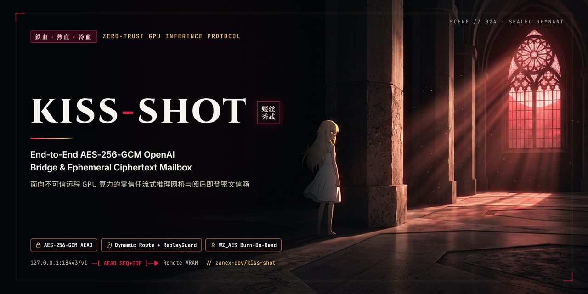

<p align="center">
  
</p>

<h1 align="center">Kiss-Shot (姬丝秀忒)</h1>

<p align="center">
  <strong>面向不可信远程 GPU 算力租赁场景的应用层端到端加密（<code>AES-256-GCM</code>）OpenAI 推理网桥与阅后即焚密文信箱。</strong>
</p>

<p align="center">
  <a href="#3-运行完整安全验证测试套件"></a>
  <a href="pyproject.toml"></a>
  <a href="LICENSE"></a>
  <a href="pyproject.toml"></a>
  
</p>

<p align="center">
  <a href="README.md"><strong>English</strong></a> · <a href="README_ZH.md"><strong>简体中文</strong></a>
</p>

---

在租用第三方云端 GPU（如 RunPod、Vast.ai、Lambda、AutoDL 或远程 Jupyter 容器）时，常规的平台 HTTPS 反向代理或穿透网关会在边缘节点终止 TLS，导致明文提示词、核心系统指令、多模态图像及生成结果暴露在边缘网关日志与共享存储之下。

**`kiss-shot`**（代号：**Kiss-Shot / 姬丝秀忒**，与本地隐私物理护盾 *Heart-Under-Blade / 刃下心* 构成姊妹安全工程）在你的本地工作站（`127.0.0.1`）与远端 GPU 推理进程内存之间直接缔结应用层零信任加密契约：

1. **透明兼容 OpenAI `/v1` 的流式 AEAD 网桥**：在本地监听 `http://127.0.0.1:18443/v1`（零改造接入 OpenAI SDK、LangChain、Cursor、Continue、OpenWebUI 或 SillyTavern），出站流量全程采用 `PBKDF2-HMAC-SHA256`（`210,000` 次迭代）+ `AES-256-GCM` 逐帧认证加密，内置严格的上下文域分离 AAD（`AAD_PAYLOAD` / `AAD_TICKET` / `AAD_BLOB` / `AAD_ARCHIVE`）与 24 小时签发时效（TTL）防陈旧重放保护。
2. **一次性动态随机路由、防重放与 SSRF 白名单**：远端网关每次启动均随机生成动态路径（`/v1/ks-<随机十六进制>`）与 128-bit 会话盐，封装在加密的 `KISSSHOT_TICKET:...` 握手票据内；配合 `±300s` 时间窗口、有界请求 ID 防重放缓存（`ReplayGuard`）、并发信号量限制与严格的上游路径白名单（`/v1/*`、`/health`），任何外部扫描器探测、越权路由或抓包重放均直接返回 `403 Forbidden`。
3. **SSE 流完整性与防截断校验**：流式响应按行绑定单调递增序号（`kissshot-s2c:<req_id>:<seq>`）与加密结束帧（`EOF:...`）作为 GCM 附加认证数据（AAD），彻底阻断中间人分片乱序、注入与静默截断。
4. **双层 AEAD 纯内存阅后即焚密文信箱**：针对异步文生图/生视频任务（`SDXL`、`FLUX.1-schnell`、`Wan 2.1/2.2`），提示词与参考图在本机加密后上传，远端于纯内存（`BytesIO` / `/dev/shm`）内完成推理，先封装为 `256-bit WinZip AES`（`WZ_AES` + `ZIP_STORED` 无压缩防侧信道 + 内层文件名混淆），再套入外层 `AES-256-GCM`（`AAD_ARCHIVE`）完整密文信封；本机采用流式防压缩炸弹校验（拒收任何 `ZIP_DEFLATED` 压缩条目并设 `2 GiB` 熔断上限），解密落盘后**立即销毁云端密文分片**。
5. **本地守护进程与凭据保险箱加固（v0.2.0）**：本地口令与令牌采用 Windows `DPAPI`（`CryptProtectData`）或 POSIX `0600` 权限保险箱静态加密；本地控制接口强制 `X-KissShot-Admin-Token` 鉴权，严格校验 `Host` 与 `Sec-Fetch-Site` 阻断浏览器 DNS Rebinding 与跨站探测，清洗响应 `Content-Type`（`nosniff`）防御反射型 XSS，并为剪贴板敏感口令注入防云同步/防历史记录标记与 90 秒自动擦除机制。

---

## 快速开始

### 1. 安装依赖

```bash
git clone https://github.com/zanex-dev/kiss-shot.git
cd kiss-shot
pip install -r requirements.txt
pip install -e .
```

### 2. 启动实时 OpenAI E2EE 加密网桥

**在远端 GPU 节点**（假设 `vLLM` / `llama-server` / `Ollama` 已绑定在容器内部 `127.0.0.1:8080`）：

```bash
kiss-shot remote-gateway \
  --public-url https://your-pod-8081.proxy.example.com \
  --listen-port 8081 \
  --upstream http://127.0.0.1:8080
```

按提示输入会话口令（仅驻留内存），复制终端打印出的整行 `KISSSHOT_TICKET:...` 握手票据。

**在本地电脑**：

```bash
# 方式 A：启动跨平台桌面图形控制台（支持剪贴板自动捕获票据秒连 + 异步密文信箱）
kiss-shot panel

# 方式 B：启动纯命令行无头加密代理
kiss-shot bridge --port 18443
```

随后将任意支持 OpenAI 接口的客户端指向 `http://127.0.0.1:18443/v1` 即可透明使用。

### 3. 运行完整安全验证测试套件

```bash
python -m unittest discover -s tests -v
```

---

## 开源许可

本项目基于 [MIT License](LICENSE) 开源发布。
