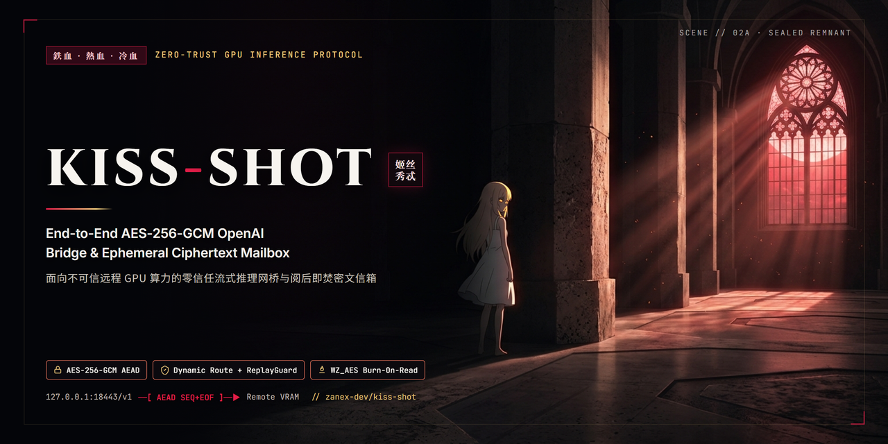

<p align="center">
  
</p>

<h1 align="center">Kiss-Shot (姬丝秀忒)</h1>

<p align="center">
  <strong>面向不可信远程 GPU 算力租赁场景的应用层端到端加密（<code>AES-256-GCM</code>）OpenAI 推理网桥与阅后即焚密文信箱。</strong>
</p>

<p align="center">
  <a href="#3-运行完整安全验证测试套件"></a>
  <a href="pyproject.toml"></a>
  <a href="LICENSE"></a>
  <a href="pyproject.toml"></a>
  
</p>

<p align="center">
  <a href="README.md"><strong>English</strong></a> · <a href="README_ZH.md"><strong>简体中文</strong></a> · <a href="CHANGELOG_ZH.md">更新日志</a>
</p>

---

在租用第三方云端 GPU（如 RunPod、Vast.ai、Lambda、AutoDL 或远程 Jupyter 容器）时，常规的平台 HTTPS 反向代理或穿透网关会在边缘节点终止 TLS，导致明文提示词、核心系统指令、多模态图像及生成结果暴露在边缘网关日志与共享存储之下。

**`kiss-shot`**（代号：**Kiss-Shot / 姬丝秀忒**，与本地隐私物理护盾 *Heart-Under-Blade / 刃下心* 构成姊妹安全工程）在你的本地工作站（`127.0.0.1`）与远端 GPU 推理进程内存之间直接缔结应用层零信任加密契约：

1. **透明兼容 OpenAI `/v1` 的流式 AEAD 网桥**：在本地监听 `http://127.0.0.1:18443/v1`（零改造接入 OpenAI SDK、LangChain、Cursor、Continue、OpenWebUI 或 SillyTavern），出站流量全程采用 `PBKDF2-HMAC-SHA256`（`210,000` 次迭代）+ `AES-256-GCM` 逐帧认证加密，内置严格的上下文域分离 AAD（`AAD_PAYLOAD` / `AAD_TICKET` / `AAD_BLOB` / `AAD_ARCHIVE`）与 24 小时签发时效（TTL）防陈旧重放保护。
2. **一次性动态随机路由、防重放与 SSRF 白名单**：远端网关每次启动均随机生成动态路径（`/v1/ks-<随机十六进制>`）与 128-bit 会话盐，封装在加密的 `KISSSHOT_TICKET:...` 握手票据内；配合 `±300s` 时间窗口、有界请求 ID 防重放缓存（`ReplayGuard`）、并发信号量限制与严格的上游路径白名单（`/v1/*`、`/health`），任何外部扫描器探测、越权路由或抓包重放均直接返回 `403 Forbidden`。
3. **SSE 流完整性与防截断校验**：流式响应按行绑定单调递增序号（`kissshot-s2c:<req_id>:<seq>`）与加密结束帧（`EOF:...`）作为 GCM 附加认证数据（AAD），彻底阻断中间人分片乱序、注入与静默截断。
4. **事务级密文队列 v2 与零 WebUI 暴露的本地视觉工作台**：针对异步文生图/局部重绘/图生视频任务（`MOSS-Image-SFT`、`SDXL`、`FLUX.1`、`Wan 2.1/2.2 T2V & I2V`、`Wan 2.2 TI2V-5B`、`HunyuanVideo-1.5`），本地桌面面板内置离线局部重绘涂抹画板、中心坐标系 `MOSS` 空间构图器、动态 LoRA 强度调节、本地 SQLite WAL 加密任务账本/发件箱（`.kissshot_jobs.sqlite3`）及 `DPAPI` / `POSIX 0600` 加密配方画廊。任务经独立 `AAD_QUEUE` 域（自动剥离队列密文中的 `hf_token`）基于 `parent_commit` 乐观并发控制（CAS）原子入队至 `_queue/v2/`，远端守护进程通过 `_claims/<job_id>.json` 租约心跳抢占执行，按固定 40 位 commit SHA 拉取模型权重（剥离全部可执行脚本、MOSS 管线仅允许白名单 SHA-256 校验代码），于纯内存（`BytesIO` / `/dev/shm`）内完成推理与可选分块 `2x Real-ESRGAN` 超分，打包为双层 AEAD（外层 `AAD_ARCHIVE` + 内层 `WZ_AES` `ZIP_STORED`）并原子提交 `_inbox/` + `_receipts/<job_id>.json`；本机按锁定 `revision` 与 `blob_id` 校验下载、`packet_id` 幂等落盘后**仅对已校验且未变更的分片执行条件销毁**。
5. **本地守护进程、供应链与凭据保险箱加固**：本地口令与令牌采用 Windows `DPAPI`（`CryptProtectData`）或 POSIX `0600` 权限保险箱静态加密；本地控制接口强制 `X-KissShot-Admin-Token` 鉴权，严格校验 `Host` 与 `Sec-Fetch-Site` 阻断浏览器 DNS Rebinding 与跨站探测，清洗响应 `Content-Type`（`nosniff`）防御反射型 XSS；SillyTavern 客户端仅允许显式单 profile 绑定并保留原始配置备份；远端 Notebook 默认绑定 `127.0.0.1`、支持引擎二进制 SHA-256 校验（`verified_engine`）、可选运行时依赖锁（`runtime_lock.py`，默认 `strict=False` 兼容放行）及仅清理 `KISSSHOT_` 敏感行的选择性 IPython 历史擦除，剪贴板口令注入防云同步/防历史记录标记并自动擦除。

---

## 快速开始

### 1. 安装依赖

```bash
git clone https://github.com/zanex-dev/kiss-shot.git
cd kiss-shot
pip install -r requirements.txt
pip install -e .
```

### 2. 启动实时 OpenAI E2EE 加密网桥

**在远端 GPU 节点**（假设 `vLLM` / `llama-server` / `Ollama` 已绑定在容器内部 `127.0.0.1:8080`）：

```bash
kiss-shot remote-gateway \
  --public-url https://your-pod-8081.proxy.example.com \
  --listen-port 8081 \
  --upstream http://127.0.0.1:8080
```

按提示输入会话口令（仅驻留内存），复制终端打印出的整行 `KISSSHOT_TICKET:...` 握手票据。

**在本地电脑**：

```bash
# 方式 A：启动跨平台桌面图形控制台（点 × 自动缩入右下角托盘保活加密网桥，支持 --minimized 静默启动）
kiss-shot panel
kiss-shot shortcut   # 可选（Windows）：一键注册开始菜单与任务栏独立图标快捷方式（附加 --remove 可移除）

# 方式 B：启动纯命令行无头加密代理
kiss-shot bridge --port 18443
```

随后将任意支持 OpenAI 接口的客户端指向 `http://127.0.0.1:18443/v1` 即可透明使用。

### 3. 运行完整安全验证测试套件

```bash
python -m unittest discover -s tests -v
```

---

## 开源许可

本项目基于 [PolyForm Noncommercial License 1.0.0](LICENSE)（`PolyForm-Noncommercial-1.0.0`）发布 —— **个人学习、自用与非营利研究免费开放；严禁将本项目代码或 `assets/` 视觉头图及美术素材用于任何商业用途、付费服务、打包倒卖或二次售卖**，商业授权请联系作者 zanex-dev。

`Required Notice: Copyright (c) 2026 zanex (zanex-dev) (https://github.com/zanex-dev/kiss-shot)`
